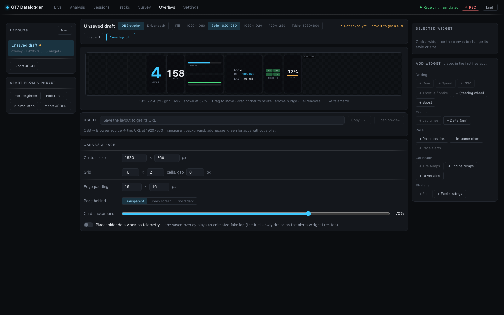

# GT7 Datalogger

[](https://github.com/jbhoorasingh/gt7-datalogger/actions/workflows/ci.yml)
[](https://github.com/jbhoorasingh/gt7-datalogger/actions/workflows/publish.yml)
[](https://github.com/jbhoorasingh/gt7-datalogger/pkgs/container/gt7-datalogger)
[](https://www.python.org/downloads/)
[](LICENSE)
[](https://jbhoorasingh.github.io/gt7-datalogger/)

A telemetry datalogger and analysis dashboard for **Gran Turismo 7**. It captures the
PlayStation's live telemetry stream, records every lap, and serves a modern dark-themed
web dashboard for live driving, lap comparison, and session management.

Maintained by [u/Rfc6878](https://www.reddit.com/user/Rfc6878/) on Reddit.

Full feature parity with [snipem/gt7dashboard](https://github.com/snipem/gt7dashboard) —
plus additional features like the lens-coloured race line map, sector times, the corner
report card with braking points, chassis event detection, track auto-identification, the
overlay builder, a voice race engineer, and webhook notifications — rebuilt with a cleaner
architecture and a modern UI.

**📖 Full documentation: [jbhoorasingh.github.io/gt7-datalogger](https://jbhoorasingh.github.io/gt7-datalogger/)** —
per-feature guides, how every calculation works, and the API reference.


## Features

### Live

- **Live view** — shift lights (with limiter flash), large speed / gear / live-delta
  readouts, current / last / best / predicted lap, a rolling throttle/brake trace,
  boost, fuel, tire temps, race position, an alert strip, and a rail of this session's
  laps with the lap in progress pinned on top (click any lap to open it in Analysis).
  A Race Engineer chip and a Driver dash link sit in the context strip.
- **Driver-aid indicators** — TCS / ASM / handbrake pills that light while the aid is
  intervening, and engine temperature warning colors for long stints.
- **Live race strategy** — fuel-to-empty countdown, pit-window lap, and race-distance fuel
  check computed from your rolling consumption, plus the in-game clock for endurance stints
  (time-of-day is also recorded per lap).

### Analysis

- **Multi-lap overlay comparison** against a selectable reference lap: time diff over
  distance plus a **channel picker** — choose from 31 telemetry channels grouped into
  Driving, Race, Engine, Tires & wheels, and Chassis (speed, throttle, brake, coasting,
  gear, RPM, boost, steering, yaw rate, lateral / longitudinal / vertical g, body slip,
  TCS cut and ABS release, race position, per-wheel slip, per-corner tire temps,
  front/rear averages, the tire-temp **F−R balance** curve, suspension travel, ride
  height, …). The panel set persists and is encoded in the URL, so a shared link
  reproduces the exact view.
- **Synced cursors** — hover one chart and the same distance point is highlighted
  everywhere: every panel, the race line map, and the Corner Detail widget.
- **Corner Detail widget** — a top-down car with four corner cells that replays the
  load-transfer story as you scrub: tire temp as cell color, suspension compression bars,
  LOCK / SPIN badges, and an F/R temp-balance readout. One focus lap at a time with the
  reference lap as a ghost (secondary figures + hollow bars).
- **Detected chassis events** — lockups, wheelspin, suspension bottoming, and kerb strikes
  are detected at lap save, shaded onto the charts (on the panel that caused them), counted
  per lap in the Sessions table (`2L·1S·4B`), and summarized in the tuning panel. TCS/ASM
  activation shades the throttle/speed panels.
- **Race line map with lenses** — the reference lap drawn as one line coloured by
  **Inputs** (throttle / brake / coast), **Speed** bands, or **Gain / loss** against the
  compared lap, over the surveyed road where the circuit has one. A **Layers** menu
  switches everything else the map draws: corner numbers, the other laps with their apex
  speeds and brake points, and markers for speed peaks (▲) / valleys (▼), kerbs, chassis
  events, and TCS / ASM activity. **Zoom** to a corner by clicking its number (or `[` /
  `]`), drag along the line, or ⌘/Ctrl + wheel; zoomed in, a locator inset, apex badges
  with every lap's minimum speed, and a callout say what the compared lap did there.
  Every chart follows the same window.
- **Lap strip** — the lap unrolled under the map, coloured like the line, with the
  track's sectors as **S1…Sn** buttons and the corner numbers at their apex; drag,
  resize, or slide the zoom window on it. A compact copy stays pinned over the charts.
- **Sector times** — every lap of the session split at the circuit's sectors (placed on
  the Tracks page, or thirds of the lap when none are), best sector and best lap in
  purple.
- **Corner report card** — entry / minimum / exit speed and time lost or gained per
  corner against the reference, with **braking columns** (brake Δ m, peak %, zone length)
  and body-slip **balance**. Hover a row to pin both brake points on the map, click it to
  zoom there; sort in track order or biggest loss first.
- **Stint trend** — lap time and tyre temperatures lap over lap, split into stints at
  pit stops, with each stint's drift as a figure (`+0.18 s/lap`).
- **Lap playback** — play / pause, a scrub bar, and 0.25×–4× speed drive the synced
  cursor: the dot runs round the race line and a strip of dashboard widgets replays the
  driver's hands.
- **Traction circle (g-g)** — lateral against longitudinal g, coloured by input zone,
  with the other laps as faint dots.
- **Race engineer post-lap notes** — the coaching findings as text, per lap, replayed
  from the stored session whether or not voice was ever on.
- **Gearing panel** — per-lap gear ratios with estimated speed at redline, tune top speed,
  and redline RPM.
- Speed-deviation consistency chart across your best laps, relative fuel-map strategy
  table, and a tuning panel with aid usage, engine health (max water/oil temp, min oil
  pressure), and event counts.
- **Cross-session comparison** — **+ Add lap…** pulls any lap ever recorded at the same
  circuit into the comparison (listed fastest first, guest chips labelled `S12·L3`),
  and the class-best benchmark row has a one-click *compare*. Alignment is
  distance-from-start, so laps line up corner-for-corner across sessions.
- **Deep links everywhere** — `#/analysis?session=…&laps=…&ref=…&ch=…` bookmarks an exact
  comparison; Sessions and Live hand laps straight into Analysis. Lap ids are global,
  so a link can name laps from other sessions and they load as guests.

### Sessions

- Browse historical sessions master–detail: a date-grouped list, and for the chosen
  session a stat strip (best, average, consistency, laps near best, fuel per lap), a
  lap-time chart, and a lap table with per-lap metrics (fuel, full throttle, full
  brake, coasting, tire spin, events, max speed). Columns that never change are hidden
  automatically, the lap in progress is pinned live, and stable per-lap colors are
  shared with every chart. Each lap's **⋯** menu opens it in Analysis or sets it as the
  reference; tick laps to exclude, export or delete them in bulk.
- Export/import laps as JSON, **CSV / MoTeC-compatible export** for MoTeC i2 or Excel,
  a whole session as a ZIP, delete laps or whole sessions, manual "log lap now", and a
  record on/off toggle. **Export analysis** compiles a session into one labelled JSON
  document — every lap measured per corner against the session's best (braking zone,
  minimum speed, time lost, line against the reference) with no raw samples.
- **Laps that count** — a race's opening lap is excluded from bests and consistency as
  *race start*, a pit out-lap as partial, and any lap can be ruled in or out by hand with
  a reason. Menus, pauses and pit stops never split or merge a session, and the session
  being recorded can be deleted once recording is paused.
- **Personal-bests board** — a **Bests** sub-tab in Sessions with each circuit's fastest counting lap
  per car across every session: time, gap to the circuit's outright best, class chip
  and filter, and one click into Analysis. Sessions can be excluded from bests —
  replays record other drivers' laps, and telemetry can't tell them from yours.

### Tracks

- **Track auto-identification** — 78 GT7 configurations are recognised out of the box,
  from signatures shipped with the app, so a fresh install tags sessions on the first
  lap without you naming anything. Naming a circuit yourself always outranks a shipped
  name, surveyed circuits identify themselves from their borders, and a lap driven the
  wrong way round a layout is tagged as its reverse rather than as the layout itself.
- **Tracks view** — every circuit the app knows and what it has: a name, a survey, an
  official layout, labelled corners, sectors. A **Needs you** list and a per-circuit
  readiness checklist say what is missing and offer the fix.
- **Survey mode** — drive the borders to capture the road; the compiled road is drawn
  under the race line in Analysis, with unsurveyed stretches called out as gaps.
- **Corner & sector editor** — name and number the corners, and place sector boundaries
  by clicking the map or from a lap's split times as a race screen showed them. Both
  travel with the circuit's bundle through export, import and sync.
- **Shared track repo** — a fresh installation pulls every shared circuit on its first
  start; **Import ▾ → Pull from shared** re-pulls on demand, applying the repo's
  corrections, and the sync client pushes your own surveys back.

### Overlays & streaming

- **Drag-and-drop overlay builder** (its own **Overlays** tab) with a live canvas: place 16 widgets
  (gear, speed, RPM, inputs, steering wheel, lap times, big delta, race position, tires,
  fuel, fuel strategy, in-game clock, engine temps, driver aids, boost, race alerts) freely on a
  snapping grid, size each from 1×1 to 4×4 cells, and pick a **visual style per widget**
  — digits, bar, arc gauge, or shift-light LED strip for the same metric.
- **Server-saved named layouts** with short stable URLs (`/overlay?layout=race-strip`):
  edit a layout in the builder and every OBS source updates without touching OBS. JSON
  export/import included; legacy URL-param overlays keep working unchanged.
- **Driver dashboard / race engineer screen** at `/dash` for a second display: built-in
  *Race engineer* and *Endurance* presets with fuel & pit-window projections, live
  delta, tire/engine health, and a full-width **alert banner** (low fuel, pit window,
  overheating, oil pressure).
- **Canvas size presets** — 1920×1080, 1920×260 strip, 1080×1920 (TikTok / Shorts),
  720×1280, or any custom size; the overlay renders at exactly those pixels.
  Green-screen page mode for apps without alpha support.

### Capture & platform

- **Robust capture** — Salsa20 decryption, heartbeat keep-alive, console auto-discovery via
  UDP broadcast, automatic reconnect, and a visible connection status indicator.
- **Rich per-lap recording** — 60 Hz sample series for 38 columns including per-wheel
  slip, per-corner tire temps, suspension travel, elevation, surface, steering, g-forces,
  body slip, and a driver-aids bitmask, plus per-lap aggregates (aid usage %, engine
  health, gearing metadata).
- **Sessions auto-split** on car change or race restart, so data never mixes — while
  menus, pauses and pit stops keep the session going.
- **Replay capture** — GT7 streams replays exactly like driving, so race replays record
  their laps, and a single-lap leaderboard replay (which ends *at* the line, before a
  lap would normally commit) is salvaged whenever GT7's own reported lap time matches
  the recording — watch the TT leader's replay, then overlay their lap against yours.
- **Simulated source** (`GT7_SOURCE=sim`) drives laps around a synthetic circuit at 60 Hz —
  including lockups, wheelspin, kerb strikes, and aid activity — so everything can be
  developed and demoed without a PlayStation. Scenarios (`GT7_SIM_SCENARIO`) stage
  races, fuel shortages, engine trouble, and a `leader_replay` for the salvage path.
- **Settings view** — set the PlayStation IP (or **Find console** on the network),
  telemetry source and packet format at runtime with no restart (persisted in the
  database). Edits are buffered and sent together with **Apply changes**. Sections for
  Connection, Sync, Race Engineer, Notifications, Overlays & dashboards, Health, Logs,
  Access and Data, a health strip across the top, and a search box: live log viewer
  with level filtering and download, connection diagnostics, one-click car-database
  updates, JSON/CSV backups of every lap, and compact / delete-everything actions.
- **Race Engineer voice callouts** — spoken lap times, personal bests, fuel range, pit
  windows, position changes, engine warnings and corner coaching, generated on the
  backend and **spoken by the browser** (`/dash` or `/engineer`) — no speaker, audio
  device, or TTS package needed on the Pi or server. Opt-in per device, one active
  speaker at a time, with verbosity modes and per-category toggles.
- **Webhook / Discord notifications** — personal bests, session summaries, overtakes,
  positions lost, and off-road excursions posted to any webhook URL (Discord URLs get
  a rich embed, others plain JSON), each event individually toggleable.
- **Sync client** — paste a sync service token and choose what to send: **tracks**
  (survey bundles of circuits with a confirmed layout, uploaded once a run has
  settled, corner labels included), **sessions** (your laps as you drive, as a private
  cloud copy) and **live** (the car's position for the service's spectate page). In
  the background with retry and backoff; per-type toggles, all off by default; the
  token is stored apart, masked, and never logged.
- Configurable units (km/h / mph), persisted in the browser; dark-themed responsive UI
  built on accessible primitives with a colorblind-validated chart palette.

## Architecture

```
PlayStation (GT7) ──UDP 33740──▶ Telemetry service (FastAPI, Python 3.12)
       ▲                          ├─ Salsa20 decrypt + typed packet parser
       └──heartbeat 33739──────── ├─ Lap detection, session grouping, metrics
                                  ├─ SQLite storage (SQLAlchemy async)
                                  ├─ REST API  (/api/…)  – history & analysis
                                  └─ WebSocket (/ws/live) – 30 Hz live stream
                                              │
                                              ▼
                                  React 18 + TypeScript + Vite + Tailwind
                                  (ECharts for high-frequency chart rendering)
```

**Why FastAPI?** Native async fits a 60 Hz UDP stream + WebSocket fan-out in one process;
Pydantic gives typed models and settings; the Python ecosystem has mature Salsa20 support.
The storage layer is behind SQLAlchemy's async engine, so SQLite can be swapped for
Postgres by changing one URL.

## Quick start (Docker)

```bash
GT7_PS_IP=<your playstation ip> docker compose up --build
```

Open http://localhost:8000 and start driving.

No PlayStation handy? Demo with the simulated source:

```bash
GT7_SOURCE=sim docker compose up --build
```

### Use the prebuilt image

Images are published to GitHub Container Registry, so you can skip the build:

```bash
TAG=latest  # amd64 (use a release tag like 0.1.0 on arm64)

docker pull ghcr.io/jbhoorasingh/gt7-datalogger:${TAG}

docker run -d --name gt7-datalogger \
  -p 8000:8000 -p 33740:33740/udp \
  -e GT7_PS_IP=<your playstation ip> \
  -v gt7-data:/data \
  ghcr.io/jbhoorasingh/gt7-datalogger:${TAG}
```

| Tag | Built from | Architectures |
| --- | --- | --- |
| `latest`, `main` | tip of `main`, every push | `amd64` |
| `sha-<short sha>` | a specific commit | `amd64` |
| `X.Y.Z`, `X.Y`, `X` | `vX.Y.Z` release tags | `amd64` + `arm64` |

**On arm64 (Raspberry Pi 4/5, Zero 2 W) pull a release tag, not `latest`** — only tagged
releases build the `arm64` leg, because emulating it on every push to `main` would triple
CI time for no one's benefit.

With Compose, `docker compose pull && docker compose up -d` runs the published image;
`docker compose up --build` still builds from source.

### Ports

| Port | Protocol | Purpose |
| --- | --- | --- |
| 8000 | HTTP | Dashboard, REST API, WebSocket |
| 33740 | UDP | Telemetry from the PlayStation |
| 33739 | UDP (outbound) | Heartbeat to the PlayStation |

> **Auto-discovery note:** broadcast discovery needs the container to share the LAN's
> broadcast domain. With the default bridge network, set `GT7_PS_IP` explicitly (recommended),
> or run with `network_mode: host` on Linux.

## Running on a Raspberry Pi (native, no Docker)

Docker is impractical on the smallest Pis — the official `python` and `node` images have
no ARMv6 build — so on a Raspberry Pi Zero W / Zero 2 W you run the backend natively and
serve a **pre-built** frontend. The capture workload itself is light (decrypt + decode a
~300-byte UDP packet at 60 Hz), so even a Zero W handles it comfortably.

> **Prefer Docker on a 64-bit Pi.** Tagged releases publish an `arm64` image, so on a
> Pi Zero 2 W / 4 / 5 running 64-bit Raspberry Pi OS you can pull a release tag
> (`ghcr.io/jbhoorasingh/gt7-datalogger:0.1.0`, **not** `:latest` — see
> [Use the prebuilt image](#use-the-prebuilt-image)) and skip this section entirely.
> The native route below stays the right answer for ARMv6 (Zero W) and for anyone who'd
> rather not run Docker.

> **Which Pi?** A **Pi Zero 2 W** (quad-core, runs 64-bit) is strongly recommended: on
> arm64 every dependency has a prebuilt wheel and the steps below "just work". A **Pi Zero W**
> (single-core, ARMv6) also works but depends on piwheels shipping ARMv6 wheels for the
> Rust-based packages (`pydantic-core`, `watchfiles`) — see the ARMv6 note at the end.

### 1. Build the frontend on your dev machine

Never run `npm run build` on the Pi (slow, and likely to run out of memory). Build it on
your laptop and copy the output across:

```bash
# on your dev machine, from the repo root
cd frontend
npm ci
npm run build          # produces frontend/dist

# copy the whole repo (or at least backend/ + frontend/dist) to the Pi
rsync -av --exclude node_modules --exclude .venv ../  pi@raspberrypi.local:~/gt7-datalogger/
```

The backend serves `frontend/dist` automatically when that folder is present, so no web
server or reverse proxy is needed.

### 2. Prepare the Pi

Use a current **Raspberry Pi OS (Trixie-based)** image, which ships Python 3.12+ (the
project requires ≥ 3.12). On an older Bookworm image you'd have to build Python 3.12
yourself. Install the build basics:

```bash
sudo apt update
sudo apt install -y python3 python3-venv python3-dev build-essential
python3 --version      # must be 3.12 or newer
```

### 3. Install the backend

Raspberry Pi OS points pip at **piwheels**, which provides prebuilt ARM wheels for
`pydantic-core`, `pycryptodome`, and friends — this is what makes the install fast instead
of an hours-long compile.

```bash
cd ~/gt7-datalogger/backend
python3 -m venv .venv && source .venv/bin/activate
pip install -e .
```

### 4. Configure

Set the console IP (or leave it unset for broadcast auto-discovery) in an `.env` file in
the directory you launch from, or as environment variables:

```bash
# ~/gt7-datalogger/backend/.env
GT7_SOURCE=udp
GT7_PS_IP=192.168.1.50        # your PlayStation's IP
GT7_DB_PATH=/home/pi/gt7-data/gt7.db
```

### 5. Run it

```bash
cd ~/gt7-datalogger/backend
source .venv/bin/activate
python -m app.main            # listens on 0.0.0.0:8000
```

Open `http://<pi-ip>:8000` from any device on the LAN. Car names work immediately — the
inventory ships with the app — and refresh themselves in the background after a GT7
content update.

### 6. Start automatically with systemd

```ini
# /etc/systemd/system/gt7-datalogger.service
[Unit]
Description=GT7 Datalogger
After=network-online.target
Wants=network-online.target

[Service]
User=pi
WorkingDirectory=/home/pi/gt7-datalogger/backend
EnvironmentFile=/home/pi/gt7-datalogger/backend/.env
ExecStart=/home/pi/gt7-datalogger/backend/.venv/bin/python -m app.main
Restart=on-failure

[Install]
WantedBy=multi-user.target
```

```bash
sudo systemctl daemon-reload
sudo systemctl enable --now gt7-datalogger
journalctl -u gt7-datalogger -f      # follow the logs
```

Make sure the Pi and PlayStation share the same 2.4 GHz network and that UDP port 33740
is not firewalled.

> **ARMv6 (Pi Zero W) note:** if `pip install` tries to compile `pydantic-core` or
> `watchfiles` from source (i.e. piwheels has no wheel for the exact version), the build
> can take a very long time or exhaust the 512 MB of RAM. Options: pin to a package version
> piwheels does provide a wheel for, add temporary swap for the one-time build, or — the
> easy path — use a **Pi Zero 2 W** on 64-bit Raspberry Pi OS, where prebuilt wheels are
> always available.

## Local development

One command from the repo root starts everything (backend with auto-reload on :8000,
frontend with hot reload on :5173) and bootstraps the venv / node_modules on first run;
Ctrl-C stops both:

```bash
./dev.sh
```

Settings come from a `.env` in the repo root — set `GT7_SOURCE=sim` there to develop
against the simulated telemetry source without a PlayStation.

<details>
<summary>Running the pieces individually</summary>

Backend (Python 3.12+):

```bash
cd backend
python -m venv .venv && source .venv/bin/activate
pip install -e ".[dev]"
GT7_SOURCE=sim python -m uvicorn app.main:app --reload
```

Frontend (Node 22+):

```bash
cd frontend
npm install
npm run dev   # http://localhost:5173, proxies /api and /ws to :8000
```

</details>

Tests and linting:

```bash
cd backend
ruff check app tests scripts
pytest
```

## Configuration

The console IP, telemetry source, and log level can be changed at runtime from the
**Settings** view; those values persist in the database and override the environment on
the next start. Everything else is environment variables (or a `.env` file in the
working directory):

| Variable | Default | Description |
| --- | --- | --- |
| `GT7_SOURCE` | `udp` | `udp` (PlayStation) or `sim` (simulated laps) |
| `GT7_PS_IP` | *(empty)* | Console IP; empty = broadcast auto-discovery |
| `GT7_DB_PATH` | `data/gt7.db` | SQLite database path |
| `GT7_CARS_JSON` | *(bundled)* | Car inventory: id → name, manufacturer, year, category, drivetrain, aspiration and the published figures. Resolves from the package, so it works whatever directory you start from |
| `GT7_CARS_CSV` | *(empty)* | Deprecated pre-0.6 `id,name` CSV. Set = read cars from here instead, names only. Kept for one release |
| `GT7_TRACK_SIGNATURES_JSON` | *(bundled)* | Shipped track signatures, synced into the `tracks` table at startup so a fresh install recognises circuits it has never seen driven. Resolves from the package, so it works whatever directory you start from. Blank turns seeding off |
| `GT7_WS_RATE` | `30` | Live stream rate to the browser (Hz) |
| `GT7_WEBHOOK_URL` | *(empty)* | Webhook for PB / session notifications (also settable in Settings › Notifications) |
| `GT7_HTTP_PORT` | `8000` | HTTP port |

### Car data

Every car GT7 publishes ships with the app, so a fresh install with no internet names cars
on its first packet. On top of that the app checks GT7's own car list in the background —
on first run, then weekly — and picks up cars added since the release was cut. Both are
best-effort: if the check fails, the bundled inventory is what you keep.

To refresh right now rather than waiting for the weekly check, use
**Settings › Health → Update car database**, or from the command line:

```bash
python backend/scripts/update_cars.py
```

That writes next to your database. To regenerate the copy committed to the repository (for
a release), use `python backend/scripts/build_car_metadata.py`.

## Lap files

Laps export/import as JSON (a lap's **⋯ → Export JSON** in Sessions / **Import lap…**) with a versioned format
(v2) containing lap metadata, detected events, gearing, and the full 60 Hz sample series
(speed, inputs, position, fuel, per-wheel slip, tire temps, suspension, driver aids, …),
so laps can be shared or backed up. v1 files from older versions import cleanly — the
newer channels are simply absent and the charts skip them.

## Troubleshooting

- **"Server up, no telemetry"** (the status bar says *No telemetry*) — check the console
  IP in **Settings › Connection** (or `GT7_PS_IP`), make sure the PlayStation
  and server are on the same network, and that UDP port 33740 isn't blocked by a firewall.
- **Wrong/garbled data (decode errors in `/api/status`)** — another tool may be consuming
  the stream, or the packet format changed after a game update.
- **No laps recorded** — laps are only recorded while the car is on track and not paused;
  the first (out) lap completes when you cross the start line.

## Related projects

- [snipem/gt7dashboard](https://github.com/snipem/gt7dashboard) — the original Python
  race-telemetry dashboard this project reached full parity with (and then extended).
- [MacManley/gt7-udp](https://github.com/MacManley/gt7-udp) — a GT7 UDP telemetry
  parser for ESP32 / ESP8266 boards, and a great reference for the packet format.
- [zetetos/gt-telemetry](https://github.com/zetetos/gt-telemetry) — a Go telemetry
  library, and the source of the **circuit captures the shipped track signatures are
  built from**: 84 recorded laps, one per configuration, published as world coordinates
  under MIT. Their coordinates are GT7's own, so they line up with ours with no
  transform — which is what makes a circuit identify itself on a fresh install before
  anyone has driven or surveyed it. Not affiliated; the captures are used with
  attribution.
- [jbhoorasingh/gt7-datalogger-track-data](https://github.com/jbhoorasingh/gt7-datalogger-track-data)
  — this project's own track data, kept separate because it changes every time somebody
  drives: surveyed border geometry for GT7 circuits, the catalog of all 121
  configurations, and the generated `signatures.json` this app vendors. The app can pull
  contributed bundles from it directly (**Tracks → Import ▾ → Pull from shared**) and,
  connected to a sync service (**Settings › Sync**), push its own surveys back once a run has settled.

## Screenshots

**Live view** — race readouts, driver-aid pills, strategy, and the clickable laps rail:


**Analysis view** — the lens-coloured race line map with its Layers menu, the lap
strip with sectors and corner numbers, lap playback, and the channel stack beneath:


**Zoomed to a corner** — the Gain / loss lens, the locator inset, apex badges with each
lap's minimum speed, brake-point pins, and the callout for the compared lap:


**Sessions view** — the session list, stat strip, lap-time chart and per-lap metrics
with event counts (`2L·1S·4B` = lockups · wheelspins · bottoming):


**OBS overlay** — one of the layouts from the overlay builder, at an exact canvas size:


**Overlays tab** — the layout builder: drag widgets on a snapping grid, resize with the
corner handle, pick a visual style per widget, and save named layouts to the server:



**Driver dashboard** (`/dash`) — the Race engineer preset on a second display: fuel and
pit-window projections, live delta, tires, engine health, and an alert banner:


**Tracks view** — the three sources of track knowledge joined, with the gaps called out:
what is surveyed, what is named, and what the official layout is:


*Screenshots were captured against the built-in simulated telemetry source on a scratch database, with the circuits pulled from the shared track repo; the Analysis screenshots show recorded laps at Mount Panorama.*
