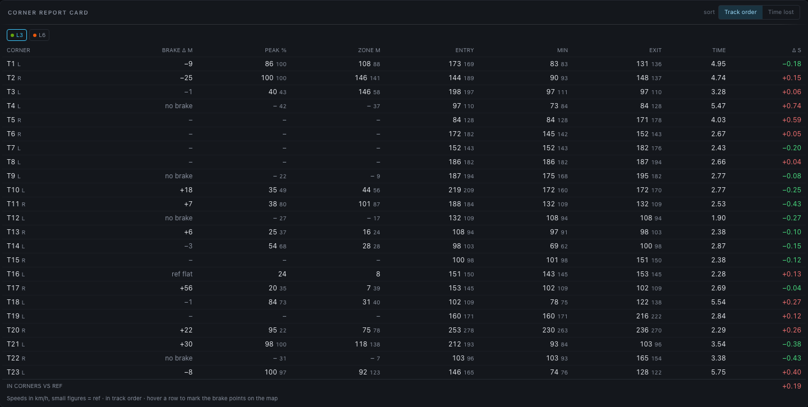
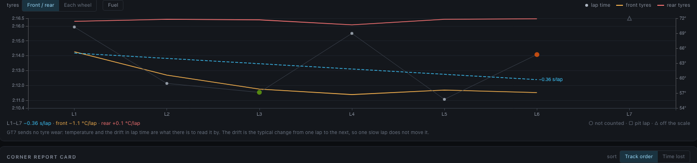
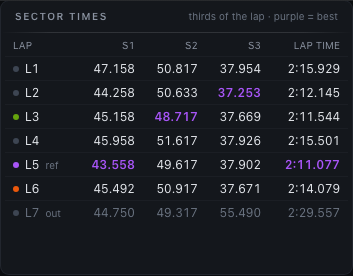

# Analysis view

`#/analysis` — overlay any number of laps against a reference lap and find where the
time goes. The x-axis everywhere is **distance into the lap**, so laps of different
speeds line up corner-for-corner (see [Lap comparison math](../internals/analysis-math.md)).

## Selecting laps

1. Pick a **session** from the dropdown (`#id · car · n laps`). The newest session with
   laps is selected by default.
2. **Click lap chips** to toggle them into the comparison.
3. **Double-click a chip** (or use the `ref:` dropdown) to make it the **reference
   lap** — the lap everything else is measured against.
4. **+ Add lap…** brings in laps from *other* sessions at the same circuit: the
   picker lists every lap ever recorded there, **fastest first** — the lap you are
   hunting for is almost always the quick one — and a picked lap joins the comparison
   as a **guest chip** labelled `S12·L3` (session 12, lap 3). Guests behave exactly
   like local laps: time diff, corner report, map, reference — all of it.

Until you pick manually, the view auto-selects *latest vs best* — best meaning the
quickest lap that [counts](sessions-view.md#excluding-a-lap-from-bests), so a pit
out-lap or an excluded lap is never the default reference — and keeps following as
new laps arrive live — useful on a second screen while driving. Any manual change pins
your selection.

A session with **no completed lap yet** — the one you have only just started driving
— says so in place of the map, and fills in by itself the moment its first lap is
finished. Changing session always starts from that session's own laps: nothing
selected for the one you were looking at comes along.

!!! note "Same circuit only"
    Every chart's x-axis is the **reference lap's** distance from the start line, and
    every other lap is placed on it by where it was on track — which works across
    sessions **on the same circuit**, and is why the picker only ever offers laps from
    this session's own circuit (it needs the session's track to be
    [named](sessions-view.md)). A lap that can't be followed along the reference's path
    keeps its own distance instead.
    Overlaying laps from different circuits would align nothing with nothing, so the
    UI doesn't offer it.

!!! tip "Deep links"
    The full selection is encoded in the URL —
    `#/analysis?session=3&laps=12,15&ref=15&ch=speed,brake&lens=tire_temp` — so a
    bookmark or shared link reproduces the selection. `ch=` and `lens=` are there only
    when the [channels](#channel-picker) or the map's [lens](#race-line-map) differ from
    the defaults; a link without them leaves the viewer's own channels and lens as
    they are. The Sessions and Live views use these links for
    their *compare* / *analyze* shortcuts. Lap ids are global, so a link may name
    laps from *other* sessions (`#/analysis?session=3&laps=12,208`) — they load as
    guest chips rather than being pruned.

## Stacked charts

The first panel is always **Time diff (s)** — each lap's gap to the reference at each
point of the track (positive = slower; where the curve climbs is where you lose time).
Below it, one panel per selected channel. Every panel runs to the end of the lap, the
line itself, not the last whole 5 m before it.

- **Synced cursors** — hover any panel and a crosshair appears at the same distance in
  every panel, on the race line map, and in the Corner Detail widget. The tooltip shows
  one column per lap, unit-formatted.
- **Zoom** — drag across any chart to zoom a section; every panel, the map, the
  [lap strip](#lap-strip) and the deviation chart crop to it. The strip's **S1…Sn**
  buttons jump to the track's sectors, `[` and `]` step through the corners, and
  **Esc**, a double-click or **Full lap** reset. A compact copy of the strip stays
  pinned over the charts as they scroll, so the zoom is always in reach with all 31
  channels on. (Mouse-wheel zoom is off on the charts on purpose so page scrolling
  stays normal; on the map, ⌘/Ctrl + wheel zooms.)
- **Event shading** — detected [chassis events](../internals/event-detection.md) shade
  the panel that explains them: lockups on Brake, wheelspin on Throttle,
  bottoming/kerbs on suspension panels; TCS activity shades Throttle, ASM shades Speed.
  Bands are tinted in the lap's color.
- **Gear choice** — the Gear panel also draws the gear GT7 suggested, and shades the
  corners taken a gear higher; see [below](#gear-choice).

### Gear choice

GT7 suggests a gear on its HUD (the *→ 3* beside the gear), and a lap now keeps the
suggestion beside the gear it was in; laps recorded before that have none. On the
**Gear** panel each lap that has suggestions gets a **dashed line** in its own colour:
the gear GT7 suggested, broken wherever it suggested nothing. The tooltip lists it under
the gear as **Suggested**.

The panel is **shaded**, in the lap's colour, through each corner the lap took a gear
high (below): inside the corner's window (the reference lap's corners, as everywhere
else), wherever the lap was in a higher gear than GT7 suggested between the entry and
its slowest point in the corner. A corner the lap got down in time for is not shaded,
although every braking lap sits above the suggestion for a while as it comes down
through the box. Past the slowest point the car is accelerating and the next gear up is
no mistake, so nothing there is shaded either.

The gear suggested for a corner is the **last suggestion** seen from the start of its
approach — 250 m before its entry, never back past the previous corner's apex — to its
slowest point. The last one rather than the one at the slowest point, because whether
GT7 keeps the hint up until then or clears it once you are in the gear it asked for has
not been checked against a console. A corner is **taken a gear high** when the gear at
its slowest point is higher than that suggestion. A corner GT7 suggested nothing for,
one across the start line, or a car in neutral or reverse at the slowest point is not
judged at all. The [Tuning panel](#side-panels) counts the reference lap's corners
taken a gear high, and the Sessions lap table every lap's
([Gear high](sessions-view.md#lap-table)).

!!! note
    When GT7 fills the suggestion — on which cars and in which modes, whether it ever
    suggests an upshift, whether a HUD setting turns it off — has not been checked
    against a console recording yet. A lap on which GT7 suggested nothing has no
    suggestion line and no shading, and is not judged.

## Lap playback

Above the charts sits a transport — **play / pause, a scrub bar, and 0.25× – 4×
speed** — that drives the same synced cursor the hover does. Press play and the lap
*happens*: the dot runs around the race line, the traction-circle marker sweeps, and the
Corner Detail widget follows, with no mouse involved.

The playhead is **distance-locked** (every compared lap sits at the same point of the
track, so the time diff under the cursor stays directly readable) but it advances on the
**reference lap's own clock** — it dwells through slow corners and sweeps down the
straights, rather than gliding at constant metres per second. The race line shows the
other laps by [time](#position-or-time-sync) meanwhile, so the gap opens up as distance
on track.

Beside the transport, a strip of the live-dashboard widgets renders the reference lap at
the playhead: the **steering wheel** turning (packet B+ recordings), the
**throttle/brake bars**, current **gear** (with GT7's suggested gear beside it, where
the lap recorded one) and **speed** — the driver's hands, replayed.

Details worth knowing:

- **Scrubbing while playing** repositions the clock and playback continues from there;
  chart *hover* is ignored while playing (the playhead owns the cursor) and works
  normally whenever playback is paused or stopped.
- Playback **pauses itself when the tab is hidden**, and under a system
  *reduced motion* preference the cursor steps a few times a second instead of
  animating every frame.
- Switching the reference lap (or the selection) rewinds to the start.

## Corner report card

Below the charts, one row per corner: entry / minimum / exit speed and the time spent
between the corner's entry and exit, for the focused lap with the reference's figures in
small type beside it. The **Δ s** column is the time lost (red) or gained (green) through
that corner vs the reference. Rows are in **track order** (T1, T2 …), which is how a lap
is remembered; the **sort** switch in the header puts the **biggest loss first** instead,
so the first row is where the lap is actually being lost. The footer sums it: your total
gap that happened inside corners rather than on the straights.

Every lap is measured through the *reference lap's* corner windows (the same
distance-from-start convention as the time-diff chart), so the times are comparable;
with more than one comparison lap, chips pick which one the card focuses on. Clicking a
row zooms every chart and the map to that corner. Corners come from the circuit's
[authored set](tracks-view.md#labelling-corners) when it has one — stable numbers and
names across sessions — otherwise from detection on the reference lap.

### Braking

Three columns say how the corner was braked for:

| Column | What it is |
| --- | --- |
| **Brake Δ m** | Where the brake went on against the reference lap, in metres along the track: `−14` is 14 m **earlier**, `+6` is 6 m later (deeper). Dimmed under 5 m, which is the same brake point |
| **Peak %** | The most brake pedal the braking zone saw |
| **Zone m** | Metres from the brake going on to its release |

A corner taken without braking has **no** figures, not zeros. Where one lap braked and
the other did not, the first column says which: *no brake* (the reference braked here,
this lap did not) or *ref flat*. The columns are left out altogether when neither lap
braked anywhere, as on an oval taken flat.

The braking point is the [race engineer's](race-engineer.md): one definition, in
`processing/corner_metrics.py`, so the card, the spoken coaching and the
[lap analysis document](../reference/lap-analysis-format.md) cannot disagree about where
you braked. How a brake application is given to a corner is in
[Lap comparison math](../internals/analysis-math.md#braking-and-balance-per-corner).

**Hovering a row** marks the two brake points on the race-line map — see
[Brake points](#brake-points).

### Balance

On a recording that carries the [body slip](../internals/derived-channels.md#body-slip-angle)
channel, two more columns say how far the car was rotated through the corner:
**Slip pk °**, the most the nose pointed into the corner past the direction the car was
travelling in, and **Slip avg °**, the same angle averaged from entry to exit. Both are
positive with the nose *into* the corner, whichever way the corner turns, so more than
the reference's small figure is more rotation — towards oversteer — and less, or a
negative figure, is the nose pushing wide. Recordings made before 0.7.0 have no such
channel, and the columns are left out.

## Stint trend

Every lap of the session on one chart: **lap time** as points against the left axis, the
**tyre temperatures** as lines against the right one, lap number across. It is there to
show tyres going away and the pace going with them, which no other panel puts side by
side.

GT7 broadcasts **no tyre wear**. How hot the tyres ran and how the lap time drifted are
the only two things there are to read it by, and the panel says so under the chart.

- **Tyres** switches the lines between *Front / rear* (each axle's average) and *Each
  wheel*. The temperature is the lap's average; hover a lap for each wheel's average and
  maximum.
- **Fuel** adds the fuel on board at the start of each lap as a dotted line. A lighter
  car is a quicker one, which hides part of what the tyres cost. The button is absent
  in a session that burned no fuel.
- The session is split into **stints at pit stops**, marked by a dashed line labelled
  *pit*. A lap the car was in the pits on is a hollow □ and belongs to neither stint,
  so an out-lap does not read as degradation and the step from worn tyres to new ones
  is not drawn as a slope.
- Laps that do not count toward bests — partial, or
  [excluded by hand](sessions-view.md#excluding-a-lap-from-bests) — are hollow ○:
  **gaps** in the trend, not points on it. A lap too slow for the scale is pinned to
  the top edge as a hollow △, so one spin cannot flatten the rest.
- Each stint has a dashed line fitted through its counting laps and the **drift** as a
  figure: `+0.18 s/lap`, with the front and rear tyres' own drift in °C a lap beside
  it. It needs three counting laps in the stint. The drift is the *typical* change
  from one lap to the next ([a median of slopes](../internals/analysis-math.md#stint-trend)),
  so one slow lap does not move it.
- Click a lap to add it to the comparison, or take it out.

The trend is worked out from the stored laps, so it is there for every session,
whenever it was recorded.

## The guide

**?** in the toolbar opens a short guide to the view: a **Features** tab with a sentence
or two on each part of the page, and a **Channels** tab explaining every chart channel —
what it shows, how to read it, and what a recording needs to have it (a wider packet
format, a race). Channels already on the chart are marked **charted**. A search box
filters both, so *understeer* or *lockup* finds the channels that show them, and every
entry links to its section of this documentation. It never opens by itself.

## Channel picker

The **Channels (n)** button opens a grouped picker with 31 channels. Hovering one shows
what it is, and **What are these?** opens the guide's channel list:

| Group | Channels |
| --- | --- |
| Driving | Speed, Throttle, Brake, Coasting, Gear, Yaw rate, **Steering**, **Throttle/Brake applied**, **TCS cut**, **ABS release** |
| Race | **Race position** — recorded only while GT7 reports positions, so the panel is simply empty on time trials |
| Engine | RPM, Boost |
| Tires & wheels | Tire spd/car spd, slip front/rear avg, slip per wheel, tire temp front/rear avg, **tire temp F−R balance** |
| Chassis | Ride height, susp travel front/rear avg, **lateral / longitudinal / vertical g**, **body slip** |

Your selection persists in the browser and is added to the URL when it differs from the
default nine-panel stack. Laps recorded before a channel existed simply skip that line.

!!! note "Understeer and oversteer, measured"
    **Body slip** is the angle between where the car points and where it is going, in
    degrees: positive with the nose to the **right** of travel, so into a right-hander
    and out of a left-hander. It is off by default, and zero below 29 km/h. The
    [corner report card](#balance) turns the sign per corner, so that rotation reads
    the same way in both directions.

!!! note "Aid intervention, measured rather than inferred"
    **Throttle applied** / **Brake applied** are the pedal *after* the aids acted on it.
    Plotted against the raw pedal the two lines separate exactly where TCS or ABS
    intervened; **TCS cut** and **ABS release** are that separation on its own. These
    need the `~` packet format or wider — see
    [Configuration](../getting-started/configuration.md).

## Sector times

Every lap of the session, split at the circuit's sectors, one row per lap in lap order.
The best of each sector and the best lap time are purple, counting only laps that count
toward bests; a pit out-lap is listed faint and holds no best. Sector times are read off
each lap's own clock where it passed the boundary, and the last sector takes whatever is
left of the lap time, so the splits add up to the figure GT7 showed.

The boundaries are **the track's own** when they have been placed — on the Tracks page,
beside the [corners](tracks-view.md#labelling-corners): each one is where a sector ends,
and the last sector runs to the start/finish line. A circuit without them is split into
**thirds of the lap**, which is what S1/S2/S3 always meant here; the panel's note says
which. Either way the boundaries are *places on the road*: on a circuit without its own,
the thirds are taken from the session's quickest lap and then found on every other lap,
so that a wider line through a corner does not move the split. A lap that never passed a
boundary (a cut, or another layout under the same name) shows no sector times.

## Race line map

A top-down plot of the reference lap's driven line, coloured by the **lens** picked in
the panel header:

- **Inputs** (the default): green = throttle, red = braking, blue = coasting.
- **Speed**: five bands from the lap's slowest to its fastest, red through amber to
  green, with the band edges in the key.
- **Gain / loss**: where the [report card's](#corner-report-card) lap is gaining time on
  the reference (green) and where it is losing it (red), read off the slope of the time
  diff over a 30 m window; grey where it is holding even. Needs a comparison lap.
- **Tire temp**: the hottest of the four tires at each point, on the scale of the Live
  view's tire tiles and [Corner Detail](#corner-detail-widget): blue below 55 °C
  (cold), green 55–95 °C (working), red at 95 °C and above (hot).
- **F−R temp**: the fronts' average tire temperature minus the rears', the
  **tire temp F−R balance** channel drawn on the line. Red where the fronts run hotter,
  blue where the rears do, grey where the two are within 3 °C of each other — exactly
  3 °C included, as Corner Detail's balance readout counts it. The colour is full from
  8 °C, the gap at which the [race engineer](race-engineer.md) calls out one axle
  running hotter; the engineer measures that over a whole lap, the map shows where on
  the lap it happens.

A lens the comparison cannot draw — Speed on a recording without the channel, Gain /
loss with only the reference selected, the tire lenses on a lap recorded before
per-corner channels existed — is greyed out in the control, with a tooltip saying why,
and the line is coloured by Inputs instead.

The lens is remembered on this device, and goes into the [link](#selecting-laps) when it
is not Inputs. Opening a link that names a lens switches to it and remembers it, as a
link's channels do. A lens the comparison cannot draw stays chosen — still in the URL,
drawn as Inputs meanwhile — and takes over once the comparison can draw it.

The [lap strip](#lap-strip) under the map is coloured the same way — the line unrolled.
Other selected laps overlay as thin lines in their chart colours. The map follows the
chart cursor, placing one dot per lap at the hovered distance so you can see the spatial
gap between lines; hovering the line on the map moves the cursor everywhere else too.

A metre across is a metre down, so a corner's shape on screen is its shape on the track.
The axis ranges follow the plotting area's pixel aspect to keep it that way in any
window; letting each axis fill the box independently stretches the map by whatever the
circuit's aspect ratio happens to be — 8 % at Lago Maggiore Centre, nearly 3× at Deep
Forest.

### Position or time sync

**sync: Time | Position** in the map header (shown once more than one lap is on the
map) chooses where the other laps' dots go:

- **Time** (the default) leaves the reference dot at the cursor and moves every other
  dot to where *that* lap had got to after the same elapsed lap time. A slower lap's
  dot trails the reference, a quicker one runs ahead, and the distance between them is
  the gap — which is what makes a gap legible while a lap plays back. Hovering a chart,
  the dots show where the other cars were when the reference reached that point. A dot
  that has finished its lap waits at its last recorded point, a few metres short of the
  line.
- **Position** puts every dot level with the reference car — at the same point of the
  track, as the charts and Corner Detail compare them. The dots then differ only by the
  line each lap took there, which is worth seeing zoomed into a corner and very little
  at circuit scale.

The choice is remembered on this device, like **Follow**. Only the map changes; the
charts, the traction circle and Corner Detail stay on distance.

Both are exact about *where* a car was. Every compared lap is
[lined up with the reference by place](../internals/analysis-math.md#lining-laps-up-by-place-on-track),
not by how far it had gone — the two differ by metres a lap, because a wider line is a
longer lap — so in Position mode "level" really means level, to within centimetres.
Time mode draws each car from its own recorded positions against its own clock,
likewise within centimetres; where GT7 **reset** a car onto the track, its dot jumps to
the new spot instead of sliding across the infield. **Lap 1 of a race** starts from the
grid rather than the line; it doesn't count as a lap time (see
[Sessions](sessions-view.md#lap-table)), and time sync can't line it up with a lap
that started at the line.

Dots and the Follow camera are placed at the exact cursor position, between the
recorded 5 m steps, so the camera pans smoothly during playback.

### Zooming the map

Everything shares one zoom window, so the map, the strip, the charts and the deviation
chart always show the same stretch. On the map itself:

- **Click a corner number** to zoom to that corner, from where the reference began
  braking for it (30 m before, or before the turn-in on a corner it did not brake for) to
  40 m past the exit. `[` and `]` step through the corners and wrap.
- **Drag along the line** to zoom to that stretch, padded 15 m either side. A translucent
  band shows the pick while you drag.
- **⌘/Ctrl + wheel** zooms about the pointer, ×0.8 or ×1.25 a notch and never narrower
  than 80 m. A plain wheel still scrolls the page.
- **Double-click**, **Esc** or **Full lap** come back out. Esc closes an open menu first.

Zoomed in, the stretch is drawn thicker over the whole lap in faint grey, a **locator
inset** in the top left shows where on the lap it is (click it to come back out), each
corner in view carries an **apex badge** with the minimum speed of every lap through it in
lap colours, and when the window is a corner a **callout** in the bottom left says what the
report card's lap did there against the reference — the time lost or gained and where it
braked. The window animates into place.

### Layers

Everything besides the reference line is a layer with a switch in the **Layers** menu,
listed only when the selected laps have something to put on it; the choices are remembered
on this device. **Track**: the surveyed road, the corner numbers. **Laps**: the other
laps (switching them off hides their markers and cursor dots too), their apex
speeds, their brake points. **Markers**: ▲ speed peaks and ▼ valleys,
kerb and off-track contact, chassis events, TCS and ASM rings. Events and the aid rings
start off; everything else starts on.

- **Events** marks where each detected [chassis event](../internals/event-detection.md)
  *began*: ◆ lockup, ● wheelspin, ✚ bottoming, ✖ kerb strike. Markers are filled with
  the lap's color, so with several laps selected the pattern is the reading — three
  diamonds in one braking zone is a lockup that happens there every lap. Hover a marker
  for the lap, the wheels and how bad it was; **click** it to zoom every panel to the
  event with 60 m of track either side. Suspension events are detected per wheel, so
  same-type events that begin within 6 m of each other are drawn as one marker naming
  all the wheels.
- **TCS** draws a hollow ring, in the lap's color, on every sample where traction
  control was cutting power. Traction control catching the car at the same exit every
  lap says the car is over the limit there; rings that disappear from one lap to the
  next without the lap getting slower say TCS can come down a step. **ASM** does the
  same for stability management with hollow squares, and starts switched off.

Every layer follows the zoom, and the key in the panel header lists only what is drawn
in the current window. Laps recorded before per-corner channels existed have no events
and no aid rings.

### Brake points

A pin marks where each lap **began braking** for one corner, in the lap's colour: the
reference's, and the lap the [corner report card](#braking) is about. The corner is the
row under the pointer in the card — or, with the pointer elsewhere, the corner the view
is zoomed to, so that clicking a row and scrolling up to the map finds the pins still
there. Hover a pin for how many metres earlier or later than the reference it is. A lap
that took the corner without braking has no pin. The map's frame widens to take in the
pins of the corner it is showing: a braking zone begins well before the corner itself.

### Lap strip

The bar under the map is the whole lap unrolled, coloured by the active lens, with the
track's sectors as **S1…Sn** buttons above it and the corner numbers under it at their
apex. The zoom window is drawn on it and driven from it:

- **Drag on empty bar** to pick a new stretch.
- **Drag an edge** of the window to resize it (never narrower than 40 m).
- **Drag inside** the window to slide it along the lap.
- **Click** (without dragging) to zoom to the corner under the pointer; click a sector
  button to zoom to that sector.

The row beneath it names the window — `T5 · left · 94 km/h min`, `Custom stretch` or
`Full lap` — with its range in metres, `‹` `›` to step through the corners, and **Full
lap** when zoomed. A compact copy of the strip is pinned at the top of the charts panel
and takes the same gestures, with the channel count, the window and the lap key beside it,
so with every channel on the zoom stays in reach while the charts scroll.

The sectors are the circuit's own when it has
[boundaries placed](tracks-view.md#labelling-corners), otherwise thirds of the lap; see
[Sector times](#sector-times). The corners come from the reference lap's curvature, or
from the circuit's [authored corners](tracks-view.md#labelling-corners) when it has them —
in which case the numbering is the same in every session, not just within this one.

### Corners

Corner numbers sit just outside each apex on the map, the current one lit in the accent
colour, and under the strip; clicking either zooms to that corner — see
[Zooming the map](#zooming-the-map). In the full-screen view a corner strip under the map
lists them as chips with `‹` `›` and **lap** for the whole circuit, and names the selected
one (`T5 · left · 94 km/h · 63°`).

### Full screen

**⤢** (top right of the map) opens the same map as large as the window will allow, which
is the difference between a squiggle and a track on anything longer than a kart circuit.
The maximized view adds **scroll to zoom** and **drag to pan** — off in the rail, where a
wheel that sometimes scrolls the page and sometimes zooms a chart is worse than one that
always scrolls — plus the selected corner's minimum speed and total angle. Escape or
**Close** returns.

**Under the line: the surveyed road.** If the session's circuit has been named *and*
[surveyed](tracks-view.md), the map draws the track itself beneath every lap — road surface,
both borders, hand-marked walls in dark red, and the start/finish line. A racing line
only means something against the road it was driven on: whether the apex was clipped,
how much kerb was used, whether there was tarmac left on the exit. Circuits with no
bundle simply draw as before. The geometry is compiled server-side
(`/api/track-outline`) — a bundle holds up to 50,000 border records and the browser
never sees them.

The road is drawn only where it was actually surveyed. Stretches the survey
never covered appear as **dashed amber "unsurveyed gap" markers** rather than
invented road — the map's own *go touch this* prompt: drive that stretch on a
[survey run](tracks-view.md) and the hole fills in.

## Traction circle (g-g)

Every moment of the lap plotted as lateral g against longitudinal g, coloured by input
zone: braking at the bottom, power at the top, corners out to the sides, and the
combined phases — trail-braking in, picking up throttle while still turning — filling
the diagonals. How much of the ring gets used is the reading; an empty middle-left and
middle-right is a car that never brakes and turns at the same time. Other selected laps
appear as faint dots in their own colours, and the four numbers underneath are the peak
g reached in each direction.

The panel appears whenever the recording has the accelerometer (packet B or wider).

!!! warning "GT7 documents no unit for these channels"
    So the app checks them rather than trusting them: the server fits each axis against
    physics the same lap recorded — lateral against `v × ω` from the driven path,
    longitudinal against `dv/dt` — which recovers both the unit and the sign. The
    footnote under the diagram reports the fit. When a lap gave too little steady
    cornering or braking to check, it says **scale unverified** and assumes m/s²: the
    shapes still compare between laps, the absolute numbers may be off by a constant.

## Corner Detail widget

A top-down car with four corner cells that replays the load-transfer story as you scrub
the charts:

- **cell color** = that wheel's tire temp (blue < 55 °C, green 55–95 °C, red ≥ 95 °C)
- **bars** = suspension compression, normalized to that lap's travel range
- **LOCK / SPIN badges** using the live thresholds (brake ≥ 20 % & slip < 0.9;
  throttle ≥ 40 % & slip > 1.1)
- **F/R temp balance** readout at the bottom

One lap is in focus at a time; the reference lap is always the *ghost* — small secondary
temps and dashed suspension levels — and a cell gets a red/blue ring when the focus lap
runs more than 3 °C hotter/cooler than the reference at that point. With 3+ compared
laps, focus chips let you switch the focus lap.

## Gearing

One lap's gearbox, as a table and as the classic sawtooth chart under it.

- **The table** gives each gear's ratio and the speed it reaches at the redline, then
  the redline itself, and GT7's top speed for the setup on laps that store one.
- **The lines**, one per gear, run from standstill to the redline (dashed), each
  labelled with its gear where it meets it. That meeting point is the table's speed
  at redline, so the table and the chart always agree.
- **The dots** are the lap itself: speed across, rpm up, a dot every 5 m, coloured like
  its gear's line. They climb a gear's line to where the driver shifted and drop to the
  next. How close each tooth tops out to the redline is the shift point; how far the
  rpm falls across a shift is the gap between those two ratios; and a top gear whose
  line runs far beyond the last dots is a gearbox longer than the circuit needs.
  Points caught mid-shift, in neutral or in reverse are left out; a long lap is thinned
  to 1,500 dots, always keeping the two either side of every shift. The white dot is
  the car at the cursor, ringed in the colour of the gear it was in, and follows hover
  and [playback](#lap-playback) like every other panel.

The lap is the [corner report card's](#corner-report-card) focus lap, the same one the
Gain / loss lens compares, or the reference when no other lap is loaded; the panel's
title names it. When the reference runs a different gearbox (a guest lap in another
car, or the same car on another setup), its dots and lines are drawn behind in grey,
the lines dashed. On the same gearbox they would only repeat the focus lap's lines, so
they are left out.

GT7 sends the ratios and the redline but never the final drive, and a lap keeps no
tire size; those two decide how fast a gear goes at a given rpm. So the lines are
**fitted to the lap**: the speed per rpm is read off the stretches where the driven wheels turned with
the road, and checked to agree across the gears
([the math](../internals/derived-channels.md#gearing-panel-math)). When the lap gives no
consistent fit (too few steady samples, or one gear all the way round an oval), GT7's
top speed for the setup stands in as top gear's speed at the redline. The line under
the chart says which.

!!! note "Laps recorded before 0.7.0"
    These hold a ratio where GT7's top speed now goes, so the table leaves the top speed
    out and there is nothing to fall back on: a lap the fit refuses shows its dots with
    no lines, and "—" for every speed at redline. A lap that fits gets the full chart,
    whenever it was recorded. The simulator's rpm does not follow its ratios, so a
    simulated lap is never fitted; its lines come from the simulator's top speed, and
    its dots do not sit on them.

## Side panels

- **Race engineer — post-lap notes** — the [race engineer's](race-engineer.md)
  coaching findings as text, in the exact wording voice would have used:
  "repeated front-left lockups into turn four", "you are braking early into turn
  six, about fifteen meters", "you lost three tenths in turn five — braked
  eighteen meters earlier and carried five kilometers per hour less at the
  apex". Grouped per lap, newest first, with the currently compared laps
  highlighted; a note that names a corner zooms the charts and map to it on
  click. The notes are **replayed** from the stored session through the same
  detector the voice engineer uses — same thresholds, same reference (the
  session best as it stood at the time), same repetition windows — so they
  exist for every recorded session, whether or not voice was ever enabled.
- **Gearing** — the focus lap's ratios and the sawtooth chart; see [Gearing](#gearing).
- **Consistency — best 5 laps** — median speed plus a deviation band across the
  session's best laps; a wide band marks corners you drive differently every lap.
- **Lap times — this session** — every lap as a point, lap number across and lap time
  up, with a line through the laps that count, the **median** dashed and a band one
  standard deviation either side of it. Under the chart: the **spread** (the standard
  deviation of the counting laps' times, and that as a percentage of the median so
  circuits of different lengths compare), the median and the best. The spread is taken
  over the laps that count toward bests and no others — a pit out-lap, a race's lap 1
  from the grid and laps [excluded by hand](sessions-view.md#excluding-a-lap-from-bests)
  are drawn hollow and left out, and a lap too slow for the scale is pinned to the top
  edge as a hollow △ so one out-lap can't flatten the rest. It needs three counting
  laps. Laps in the current comparison take their chart color; click any point to add
  that lap to the comparison or take it out.
- **Fuel strategy** — the relative [fuel-map table](../internals/fuel-strategy.md):
  for each setting −5…+5 vs the reference lap's, projected fuel/lap, laps remaining,
  time remaining, and lap-time cost.
- **Tuning info (reference lap)** — max speed, min ride height, input percentages, tire
  spin, fuel used, car category, aid usage (TCS/ASM %), engine health (max water/oil
  temp, min oil pressure), **Corners a gear high** — of the corners GT7 suggested a gear
  for, how many the reference lap took in a higher one ("2 of 9"; see
  [Gear choice](#gear-choice), and left out when GT7 suggested nothing) — and the
  detected-event summary. When the circuit is named and
  the car's class is known, it also shows the **class benchmark** — the fastest full lap
  ever recorded at this circuit in the same category (laps excluded by hand never
  set it, and a reference lap that doesn't count is not measured against it), the gap
  to the reference lap, a
  link to open it, and **compare**, which pulls the benchmark lap straight into the
  current comparison as a guest chip — the question the benchmark raises ("where does
  it gain?") answered in the same view that raised it. Scoped by class on purpose: a
  Gr.3 time and an N100 time around the same corners are not the same achievement.
  Sessions [excluded from bests](sessions-view.md#excluding-a-session-from-bests) never
  provide the benchmark — a replay of the leaderboard leader is not *your* class best.
