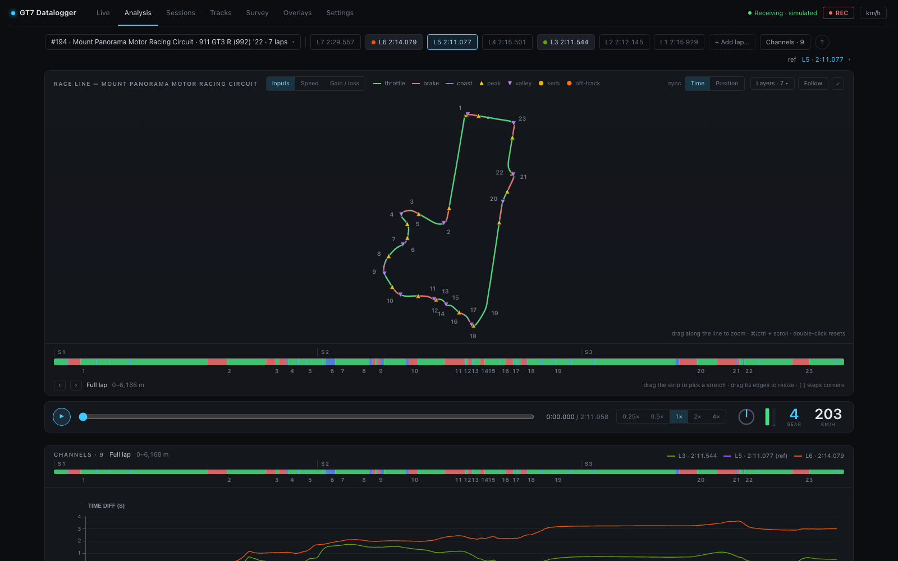
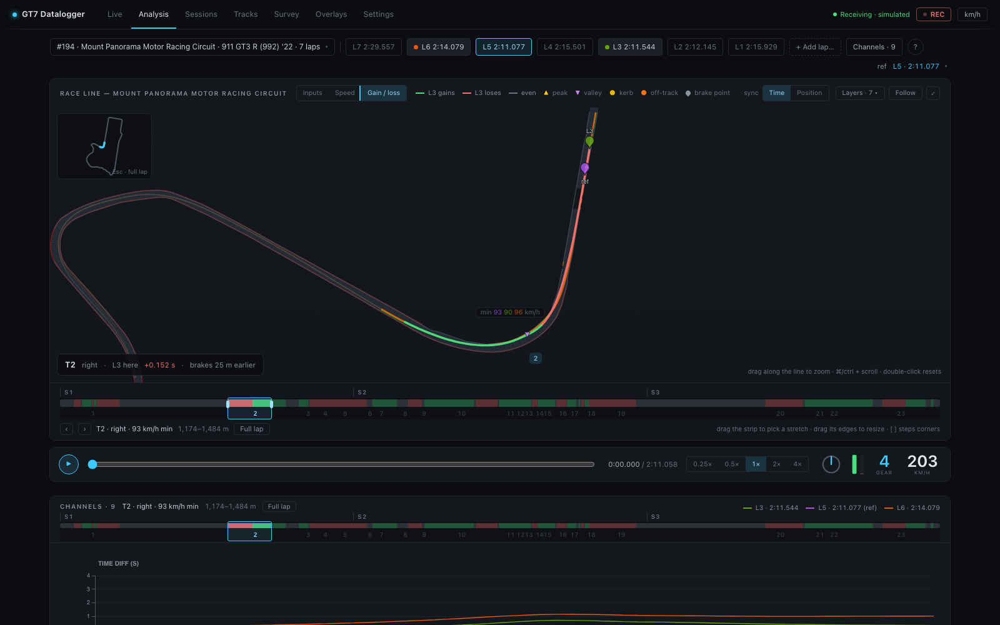
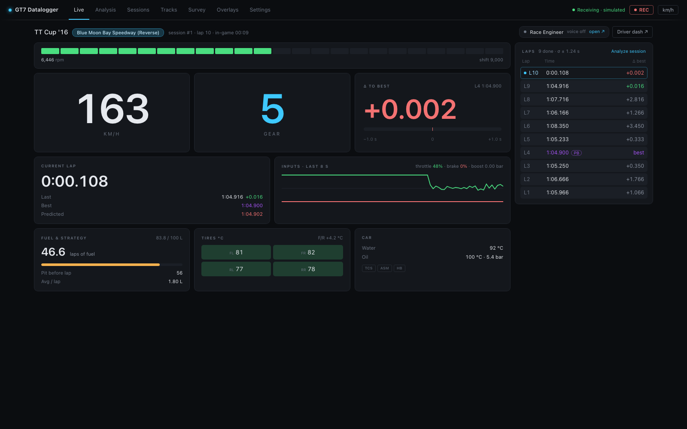
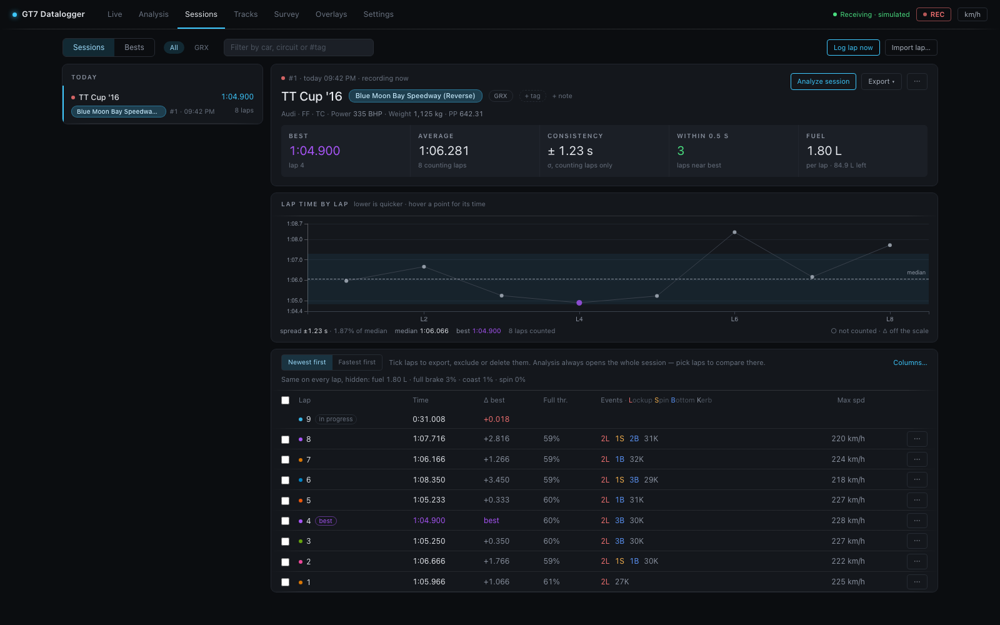
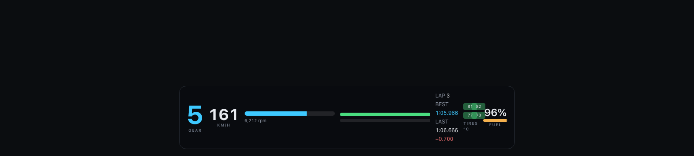
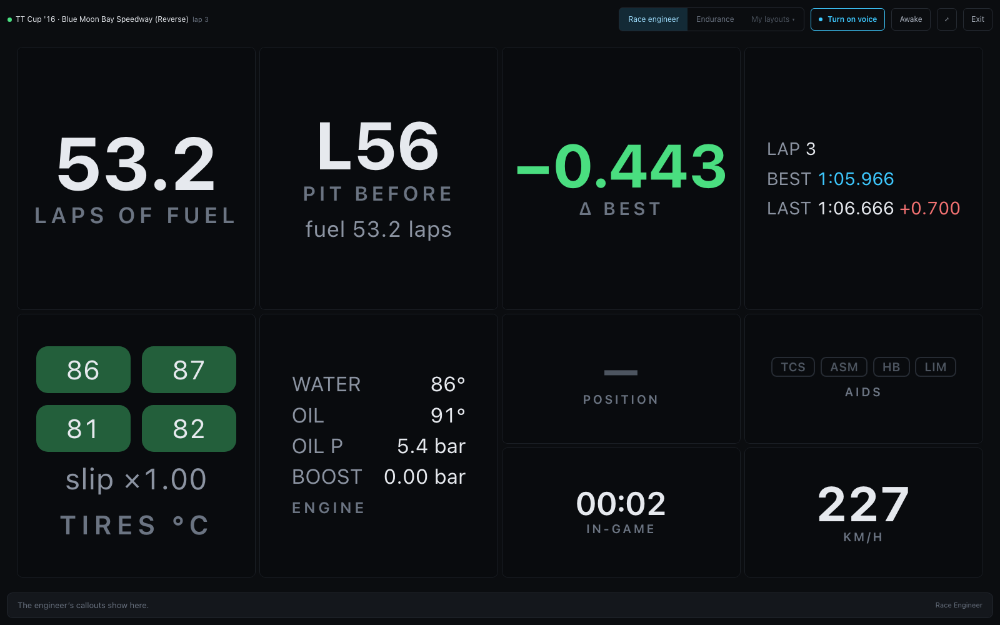
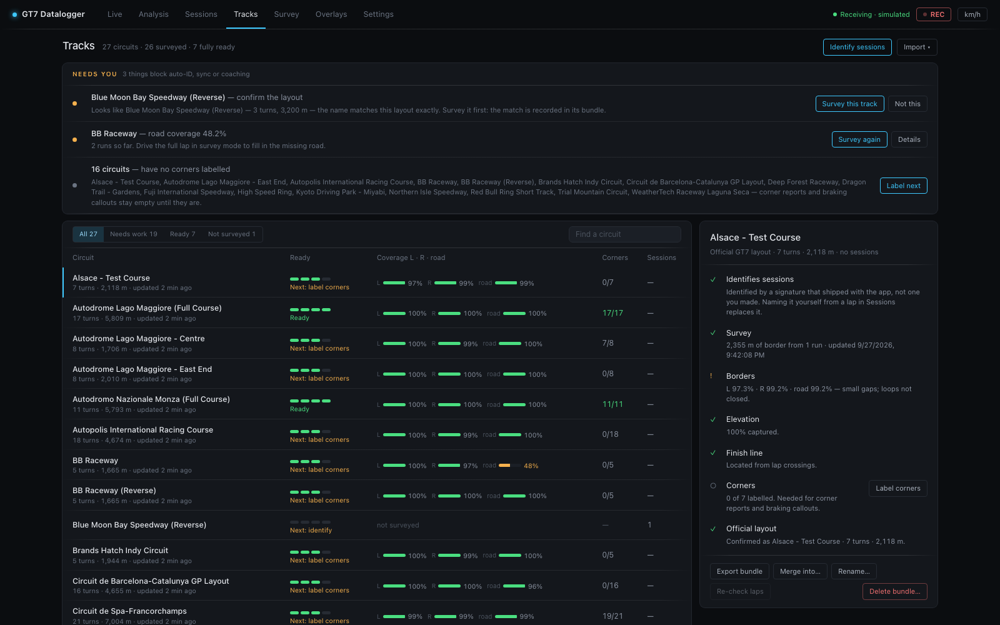

# GT7 Datalogger

A telemetry datalogger and analysis dashboard for **Gran Turismo 7**. It captures the
PlayStation's live telemetry stream, records every lap, and serves a modern dark-themed
web dashboard for live driving, lap comparison, race strategy, and session management.



## What it does

GT7 streams encrypted telemetry over UDP at 60 Hz while you drive. GT7 Datalogger:

1. **Captures** that stream — Salsa20 decryption, heartbeat keep-alive, auto-discovery,
   automatic reconnect.
2. **Records** every lap — 39 columns at 60 Hz including per-wheel slip, per-corner
   tire temps, suspension travel, g-forces and body slip, plus per-lap aggregates and
   detected chassis events (lockups, wheelspin, bottoming, kerb strikes).
3. **Serves** a web dashboard — live race readouts, multi-lap analysis with synced
   cursors and a race line map, session history, and a fully customizable OBS/phone
   overlay builder.

Everything runs in a single container (or natively on hardware as small as a Raspberry
Pi Zero) and is viewed from any browser on your network.

## Quick start

```bash
GT7_PS_IP=<your playstation ip> docker compose up --build
```

Open <http://localhost:8000> and start driving. No PlayStation handy? Run
`GT7_SOURCE=sim docker compose up --build` for a fully simulated demo.
→ [Full quick-start guide](getting-started/quick-start.md)

## The views

The web UI's tabs are **Live · Analysis · Sessions · Tracks · Survey · Overlays ·
Settings**, plus two full-screen pages for a second screen: `/dash` and `/engineer`.

<div class="grid cards" markdown>

- **[Live view](guide/live-view.md)** — big race readouts: shift lights, speed, gear,
  live delta, timing, an input trace, fuel strategy, tires, driver-aid pills, alerts,
  and a clickable rail of this session's laps.

- **[Analysis view](guide/analysis-view.md)** — overlay multiple laps against a
  reference: 31 telemetry channels, time-diff over distance, synced cursors, a
  lens-coloured race line map that zooms to a corner, a lap strip with sectors, sector
  times, a corner report card with braking points, stint trend, lap playback, and
  detected events.

- **[Sessions view](guide/sessions-view.md)** — browse history session by session:
  stats, a lap-time chart and per-lap metrics; export laps as JSON or CSV/MoTeC,
  import shared laps, and the [Bests board](guide/bests-view.md).

- **[Tracks view](guide/tracks-view.md)** — what each circuit has (a name, a survey,
  an official layout, labelled corners), what is missing, and the fix for each.

- **[Overlays & streaming](guide/overlay.md)** — build a custom overlay for OBS, a
  phone dashboard, or a pit-wall tablet: place and style widgets on a grid, pick a
  canvas size, save named layouts.

- **[Settings](guide/settings.md)** — connection, sync, Race Engineer, notifications,
  health, logs, access and data, changed at runtime with no restart.

</div>

## Screenshots

**Analysis view zoomed to a corner** — the Gain / loss lens, the locator inset, apex
badges with each lap's minimum speed, brake-point pins, and the callout:



**Live view** — race readouts, driver-aid pills, strategy, and the clickable laps rail:



**Sessions view** — the session list, stat strip, lap-time chart and per-lap metrics
with event counts (`2L·1S·4B` = lockups · wheelspins · bottoming):



**OBS overlay** — one of the layouts from the overlay builder, at an exact canvas size:



**Driver dashboard** — the Race engineer preset for a second display during the race:



**Tracks view** — what is surveyed, what is named, and what the official layout is:



*Screenshots were captured against the built-in simulated telemetry source on a scratch database, with the circuits pulled from the shared track repo; the Analysis screenshots show recorded laps at Mount Panorama.*

## How it works

Curious about the internals? The **How it works** section explains the machinery in
detail:

- [Architecture](internals/architecture.md) — how capture, processing, storage, and the
  UI fit together
- [Telemetry capture](internals/telemetry-capture.md) — the GT7 UDP protocol, Salsa20
  decryption, and every decoded field
- [Lap detection & sessions](internals/lap-detection.md) — how laps are cut from the
  stream and grouped into sessions
- [Derived channels & metrics](internals/derived-channels.md) — the math behind every
  computed channel and per-lap aggregate
- [Chassis event detection](internals/event-detection.md) — how lockups, wheelspin,
  bottoming, and kerb strikes are found
- [Fuel & race strategy](internals/fuel-strategy.md) — the live pit-window and
  fuel-to-empty calculations

## Credits & related projects

GT7 Datalogger has **full feature parity with
[snipem/gt7dashboard](https://github.com/snipem/gt7dashboard)** — the original Python
race-telemetry dashboard — plus additional features: the analysis channel picker,
Corner Detail widget, chassis event detection, track auto-identification, the
overlay builder, and webhook notifications, all rebuilt on a cleaner architecture with
a modern UI.

Also see [MacManley/gt7-udp](https://github.com/MacManley/gt7-udp), a GT7 UDP telemetry
parser for ESP32 / ESP8266 boards and a great reference for the packet format.

The [shipped track signatures](internals/track-identification.md#the-shipped-signatures)
are built from the circuit captures published by
[zetetos/gt-telemetry](https://github.com/zetetos/gt-telemetry) — 84 recorded laps, one
per configuration, released under MIT. Their world coordinates are GT7's own, so they
need no transform to line up with ours, which is what lets a circuit identify itself on
an install where nobody has driven or surveyed anything. Not affiliated; used with
attribution.

This project's own track data lives in
[gt7-datalogger-track-data](https://github.com/jbhoorasingh/gt7-datalogger-track-data),
separate because it changes every time somebody drives rather than every release.

Licensed under the
[MIT License](https://github.com/jbhoorasingh/gt7-datalogger/blob/main/LICENSE).
